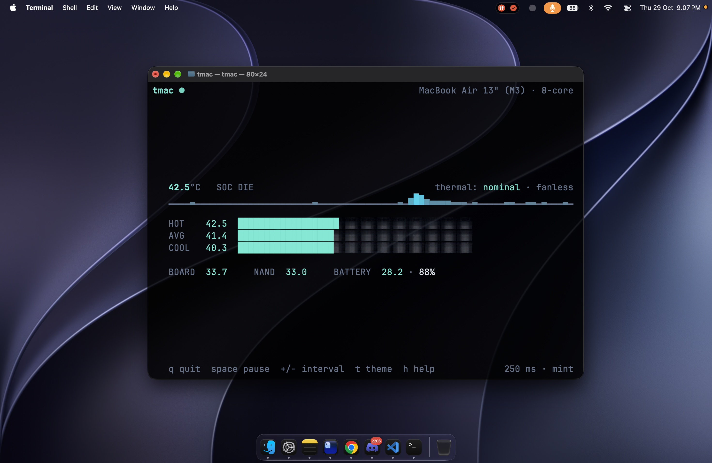

# tmac

A small terminal temperature monitor for Apple silicon Macs. One screen, a few
readings, no daemon.

I wrote it for my MacBook Air M3. I wanted to see how the SoC behaved during
long builds without keeping a full system monitor open. macOS does not expose
die temperatures through a public API, so tmac reads the same private IOHID
sensors that other Mac temperature tools use.



*Terminal.app at 80×24.*

## Build

You need macOS 12 or newer on Apple silicon, plus the Xcode command line tools.

```sh
make
./tmac
```

To install it:

```sh
sudo make install                  # /usr/local/bin
make install PREFIX="$HOME/.local" # or somewhere in your PATH
```

Remove it with `make uninstall` (add the same `PREFIX` if you installed it
somewhere else).

## Usage

```sh
tmac                    # live view
tmac --once             # one reading, then exit
tmac --interval 500     # sample every 500 ms
tmac --theme ice        # mint, ice, or mono
tmac --plain            # live view without colors
```

When stdout is not a terminal, tmac prints a single reading and exits. That
makes it usable from scripts:

```sh
tmac --once | grep "SOC die"
```

### Options

| Option            | Description                                     |
| ----------------- | ----------------------------------------------- |
| `--once`          | Print one snapshot and exit                     |
| `--interval <ms>` | Sampling interval, 100 to 5000 ms (default 250)  |
| `--theme <name>`  | `mint`, `ice`, or `mono`                        |
| `--plain`         | Disable colors                                  |
| `-h`, `--help`    | Show help                                       |
| `-v`, `--version` | Show version                                    |

### Keys

| Key         | Action                   |
| ----------- | ------------------------ |
| `q` / `esc` | Quit                     |
| `space`     | Pause or resume          |
| `+` / `-`   | Change sampling interval |
| `t`         | Next theme               |
| `r`         | Clear the graph          |
| `h`         | Toggle help              |

## What the numbers mean

The large number is the hottest PMU die sensor. The three bars break the die
readings down into hottest, average, and coolest across all channels. That is
more useful than one number when the cores are unevenly loaded.

The second row shows the board sensors (`PMU tdev`), the NAND temperature, and
the battery pack temperature with its charge level. The thermal state on the
right comes from the system pressure notification: `nominal`, `fair`, `serious`,
or `critical`. On a MacBook Air it also says `fanless`, because there is no fan
reading to show.

The sparkline keeps the last 400 samples and draws the most recent window that
fits the terminal. Values are eased slightly for display; the raw readings are
what the sensors report.

## How it works

Temperature sensors on Apple silicon are exposed as IOHID event services with
usage page `0xff00` and usage `5`. tmac creates an `IOHIDEventSystemClient`,
matches those services once at startup, and reads each one with
`IOHIDServiceClientCopyEvent()` on every poll. The services are grouped by name
(`PMU tdie`, `PMU tdev`, `NAND`, `gas gauge battery`), and unused channels that
report around `-1 °C` are ignored.

Battery percentage comes from the `AppleSmartBattery` IORegistry node. Thermal
pressure comes from the Darwin notification state
`com.apple.system.thermalpressurelevel`.

The renderer builds a whole frame and writes it once per tick at 20 FPS.
Sensor polling runs at 4 Hz by default and is independent of the frame rate, so
the animation stays smooth without reading the HID stack 20 times a second. The
terminal is put in raw mode, the alternate screen is used, and everything is
restored on exit, `Ctrl-C`, `SIGTERM`, and `SIGHUP`.

`src/sensors.c` handles IOHID and IORegistry, `src/ui.c` does the terminal
rendering, and `src/main.c` contains the loop, flags, and key handling. There
are no external dependencies beyond IOKit and CoreFoundation.

## Caveats

- The IOHID interface used here is private. It works without root on current
  macOS, but Apple can change it in any release. It is not something I would
  ship on the App Store as is.
- MacBook Air models are fanless, so there is no fan speed to display.
- The sensor set differs between chips and models. tmac was written and tested
  on a MacBook Air M3 running macOS 27; other Apple silicon Macs should work,
  but the number of die and board channels can differ.
- Readings come straight from the PMU and are not calibrated. Do not use them
  as a substitute for proper thermal testing.
- Some values change slowly and others jump by a degree or two; that is the
  sensor, not the chart.

## Status

Personal project, built for my own machine. The sensor access is the fragile
part; if a macOS update changes it, the tool will need a fix.
